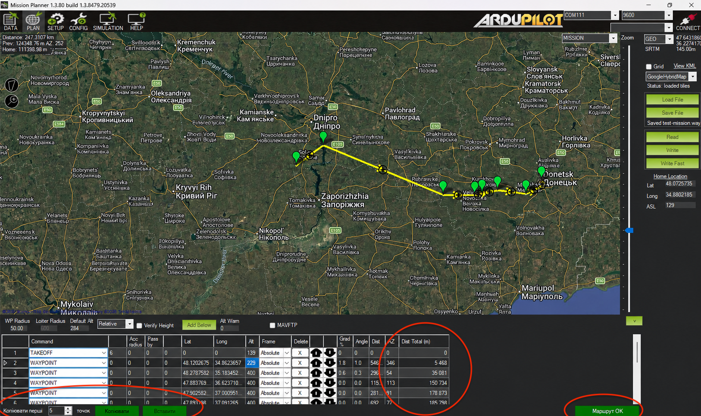
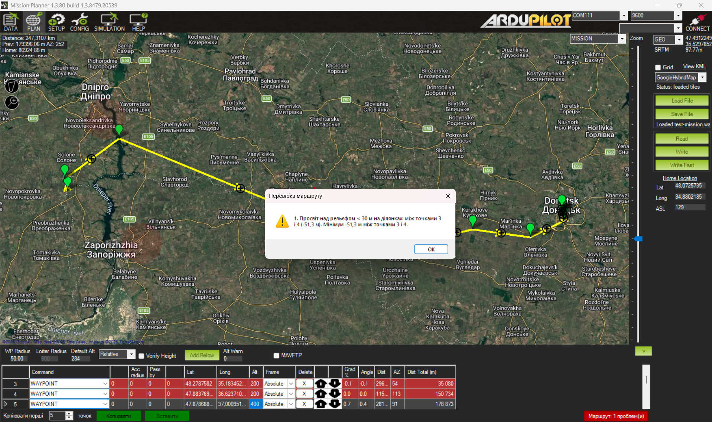
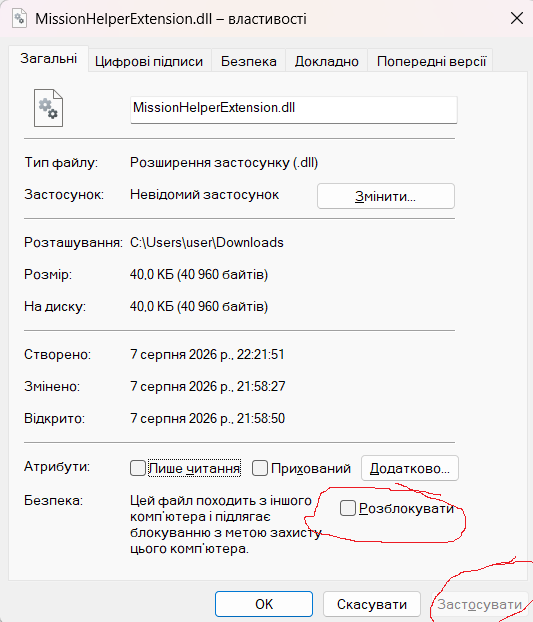

# Mission Helper Extension

Розширення (плагін) для наземної станції керування **Mission Planner** (ArduPilot), що
вбудовується в таблицю точок маршруту у вікні планувальника (*Flight Planner*) і додає
інструменти для швидшого й безпечнішого планування місій.

| | |
|---|---|
| **Назва плагіна** | MissionHelper Extension |
| **Бібліотека** | `MissionHelperExtension.dll` |
| **Версія** | 1.0.0 |
| **Платформа** | .NET Framework 4.8 |
| **Мова інтерфейсу** | Українська |


*Доданий плагіном рядок керування та стовпці у Mission Planner.*

---

## Що робить плагін


Після запуску Mission Planner плагін автоматично знаходить таблицю точок маршруту й додає
до неї три функції. Усі вони працюють у реальному часі: перераховуються та перевіряються
при кожній зміні таблиці, а також при завантаженні нового файлу місії.

Плагін не змінює саму місію без дії користувача — він лише додає інформацію (стовпець
відстані), кнопки для копіювання точок і візуальну перевірку коректності маршруту.


---

## Функції

### 1. Загальна відстань маршруту

*Стовпець `Dist Total (m)` у таблиці точок.*

Додає до таблиці новий стовпець, що показує **наростаючу відстань** від початку маршруту
до кожної точки — тобто суму довжин усіх відрізків до цієї точки включно.

- Значення оновлюються автоматично при будь-якій зміні: редагуванні, додаванні чи
  видаленні точки.
- Стовпець доступний лише для читання і округлюється до цілих метрів.
- Дає змогу одразу бачити загальну довжину маршруту та відстань до кожної точки.

<!--  -->

### 2. Копіювання та вставка точок(для побулови перших N точок від старту для борта 1 і копіювання його на інші маршрути)

*Панель керування під таблицею точок.*

Дозволяє швидко скопіювати перші кілька точок маршруту й вставити їх на початок місії —
зручно, коли кілька місій мають спільний блок зльоту або підходу.

- **Поле «Копіювати перші N точок»** — кількість точок для копіювання (від 1 до 100, за
  замовчуванням 5).
- **Кнопка «Копіювати»** — зберігає обрану кількість перших точок разом з усіма
  параметрами: команда, Param1–4, широта, довгота, висота та система координат (Frame).
- **Кнопка «Вставити»** — вставляє збережені точки на початок місії (перед першою точкою)
  через штатний API Mission Planner.
- **Рядок стану** — повідомлення про результат: «Скопійовано N точок», «Вставлено N точок»
  або «Немає точок для вставки».

<!--  -->

### 3. Валідатор маршруту


*Як відображаються помилки.*

*Кнопка стану та підсвічування помилок у таблиці.*

Автоматично перевіряє маршрут за набором правил і показує загальний стан кольоровою
кнопкою. Проблемні точки підсвічуються червоним прямо в таблиці.

| Стан | Значення |
|---|---|
| 🟢 **Маршрут OK** | усі правила виконано |
| 🔴 **Маршрут: N проблем(и)** | є порушення |
| ⚪ **Немає маршруту** | точок для перевірки немає |

<!--  -->

#### Як це працює

- Перевірка запускається автоматично при редагуванні таблиці та при завантаженні файлу
  місії.
- Наведення на кнопку показує підказку з переліком усіх знайдених проблем.
- Натискання на кнопку відкриває вікно з пронумерованим списком помилок.
- Рядки з помилками підсвічуються червоним; після виправлення підсвічування зникає.
- Перевірка просвіту над рельєфом (правило 8) виконується **у фоні й не блокує Mission
  Planner** — поки вона триває, кнопка показує «…», а підказка — «Перевірка рельєфу…».

#### Правила перевірки

1. **Перша точка** має бути `TAKEOFF` з кутом тангажу (Param1) рівно **6°**.
2. **Перша точка (TAKEOFF)** має бути на **90–110 м вище дому**. Висота дому береться з
   поля «Home Alt» у планувальнику; оскільки система координат — Absolute, обидві висоти
   рахуються від рівня моря (AMSL).
3. **Друга точка** має бути на **9–11 м вище точки зльоту (TAKEOFF)** — тобто її висота
   на 9–11 м більша за висоту першої точки.
4. **Третя точка з кінця** має бути `DO_CHANGE_SPEED` зі швидкістю (Param2) рівно **42**.
5. **Остання точка** має бути `LAND`.
6. **Азимут (AZ)** останніх чотирьох точок має збігатися (з допуском 1°), ігноруючи 3-тю
   з кінця — це команда з азимутом 0.
7. **Система координат (Frame)** усіх точок має бути `Absolute`.
8. **Кут (Angle)** кожної точки має бути в межах **[−2°, +2°]**. Для точки `LAND`
   дозволено ширший діапазон зниження **[−50°, −20°]**.
9. **Просвіт над рельєфом** на всьому маршруті має бути **не менше 30 м**. Зліт (набір
   висоти від точки TAKEOFF) і посадку (зниження до точки LAND) виключено, бо там висота
   природно мала. Кожна ділянка між точками маршруту дискретизується приблизно кожні 30 м,
   а висота рельєфу береться з даних SRTM Mission Planner (те саме джерело, що й графік
   висот).

> **Про перевірку рельєфу.** Вона виконується асинхронно у фоні на кожну зміну геометрії
> маршруту, тож інтерфейс Mission Planner не «підвисає». Якщо дані SRTM для району ще не
> завантажені, частину точок буде пропущено, і про це буде повідомлення — повторіть за
> кілька секунд, коли плитки рельєфу завантажаться.

---

## Збірка

Потрібен .NET SDK (плагін націлено на .NET Framework 4.8; референсні збірки
підтягуються з NuGet, тож збирати можна на macOS/Linux/Windows).

```bash
dotnet build MissionHelperExtension/MissionHelperExtension.csproj
```

Готова бібліотека з’явиться у `MissionHelperExtension/bin/Debug/net48/MissionHelperExtension.dll`.

Бібліотеки Mission Planner (`MissionPlanner.exe`, `MissionPlanner.Utilities.dll`,
`MAVLink.dll`, `GMap.NET.Core.dll`) очікуються в теці `lib/` — скопіюйте їх зі свого
встановлення Mission Planner.

## Встановлення

1. Повністю закрийте Mission Planner (щоб файл не був заблокований).
2. Скопіюйте `MissionHelperExtension.dll` до теки плагінів Mission Planner
   (зазвичай `C:\Program Files (x86)\Mission Planner\plugins\`).
3. Перевірте чи dll файл не заблокований
    
4. Запустіть Mission Planner і відкрийте вкладку планування маршруту.


## Діагностика

Плагін веде власний журнал (незалежно від того, як запущено Mission Planner):

```
%TEMP%\MissionHelperExtension.log
```

Якщо після встановлення функції не з’являються — відкрийте цей файл: він містить
послідовність запуску (`Init` → `Loaded` → пошук таблиці → ініціалізація кожної функції)
та будь-які помилки (`ERROR initializing …`). Відсутність файлу означає, що плагін не
завантажується взагалі (перевірте теку та сумісність версії).

---

*Mission Helper Extension · Документація функцій · Інтерфейс українською мовою.*
